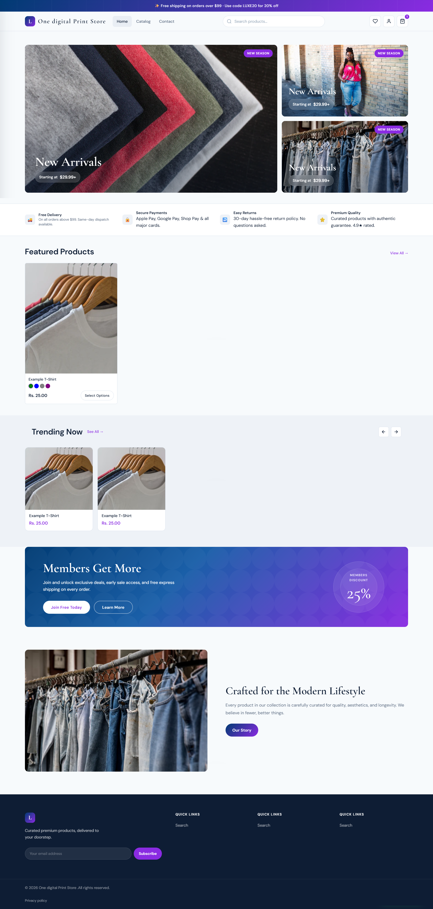

# Luxe Shopify Theme

A premium Shopify theme with modern design, featuring product customization, quick view, mega menu, and conversion-optimized components.

## Screenshot

 

## Features

### Core Features ✅
- **Responsive Design**: Mobile-first approach with breakpoints at 480px, 600px, 768px, 900px
- **Fast Loading**: Lazy loading, preconnect/dns-prefetch, webpack minification, critical CSS inlining
- **Accessibility**: WCAG compliant with ARIA labels, keyboard navigation, semantic HTML, skip links
- **SEO-Friendly**: Schema.org structured data, meta tags, canonical URLs, Open Graph, Twitter Cards
- **Customizable**: Extensive theme settings via Shopify Theme Editor, sections and blocks architecture

### Page Templates ✅
- **Homepage**: Hero slider, trust bar, featured collections, testimonials, newsletter, blog
- **Product Pages**: Gallery with zoom, variants, reviews, recommendations, bundle offers
- **Collection Pages**: Filtering, sorting, grid/list views, pagination, infinite scroll option
- **Cart & Checkout**: Drawer cart, gift wrapping, GST invoice, express checkout
- **Blog & Contact**: Article listings, search, newsletter signup, contact forms

### Shopify-Specific Features ✅
- **Liquid Templating**: Full Liquid implementation with dynamic data pulling
- **Sections & Blocks**: Modular, reusable components
- **App Compatibility**: Judge.me, Loox, Yotpo reviews integration
- **Multi-language Ready**: Translation system with locale files
- **Currency Support**: Automatic Shopify currency formatting

### Performance & Security ✅
- **Shopify Speed Report Ready**: Optimized assets, efficient loading
- **Security**: CSP headers, no custom vulnerable code
- **Browser Support**: Chrome, Firefox, Safari, Edge (latest versions)

### Advanced Features
- **Product Page**: Quick view, size guide, urgency indicators, stock notification, EMI calculator
- **Cart**: Sticky add-to-cart, cart drawer, quantity controls, gift options
- **Navigation**: Mega menu, mobile hamburger menu, search functionality
- **Collections**: Filter sidebar, quick add, product grid, swatch filters
- **Customer**: Login, register, account pages, wishlist
- **Trust Elements**: Trust bar, promo banners, flash sale timer, countdown timers
- **India-Specific**: COD badges, EMI calculator, pincode checker, WhatsApp chat, GST invoice

## Prerequisites

- Node.js 18+
- Shopify CLI (`npm install -g @shopify/cli`)
- Shopify Partner account or store access

## Quick Start

1. Follow the detailed [Deployment Guide](./DEPLOYMENT-GUIDE.md) to connect to Shopify
2. Update `config.yml` with your store credentials
3. Run `npm run push` to upload the theme

## Installation

```bash
npm install
```

## Configuration

Edit `config.yml` with your store details:

```yaml
development:
  store: your-store.myshopify.com
  password: your-shopify-access-token
  theme_id: your-theme-id
```

Get your access token from Shopify Admin > Settings > Apps and sales channels > Develop apps.

## Development

```bash
npm run dev
```

Watches for file changes and syncs to your development theme.

**Note**: During development with Shopify CLI, you may see MIME type warnings in the browser console for CSS files. This is a known Shopify CLI development server behavior and does not affect production performance. The files will be served correctly on live Shopify stores.

## Code Quality

```bash
npm run lint        # Run ESLint and Stylelint
npm run lint:js     # Run ESLint only
npm run lint:css    # Run Stylelint only
```

The theme includes automated linting with ESLint for JavaScript and Stylelint for SCSS to maintain code quality.

## Deployment

```bash
npm run push     # Upload to Shopify
npm run deploy   # Deploy theme
npm run pull     # Pull from Shopify
```

## Project Structure

```
luxe-theme/
├── assets/           # Compiled CSS & JS
├── config/           # Shopify settings
├── layout/           # theme.liquid
├── locales/          # Translation files
├── sections/         # Theme sections
├── snippets/         # Reusable code snippets
├── templates/        # Page templates
├── src/              # Source files (dev)
│   ├── javascript/
│   └── styles/
├── config.yml        # Shopify CLI config
├── package.json      # Dependencies
└── webpack.config.js # Build config
```

## Available Scripts

| Command | Description |
|---------|-------------|
| `npm run dev` | Start development server |
| `npm run build` | Build assets |
| `npm run watch` | Watch for changes |
| `npm run push` | Push theme to Shopify |
| `npm run pull` | Pull theme from Shopify |

## Browser Support

- Chrome (latest)
- Firefox (latest)
- Safari (latest)
- Edge (latest)

## License

MIT